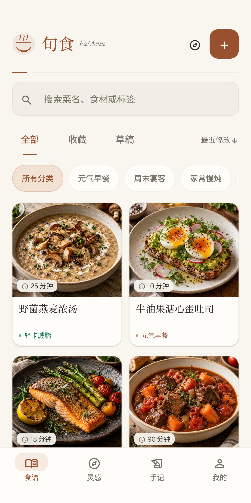
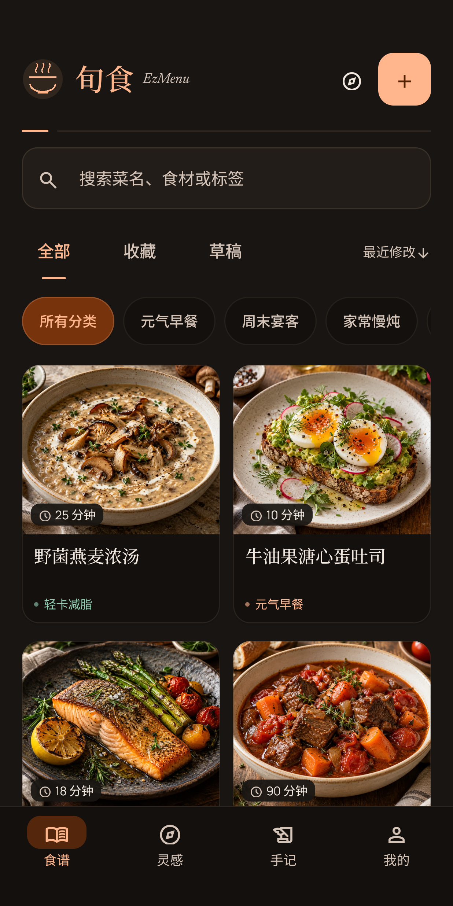
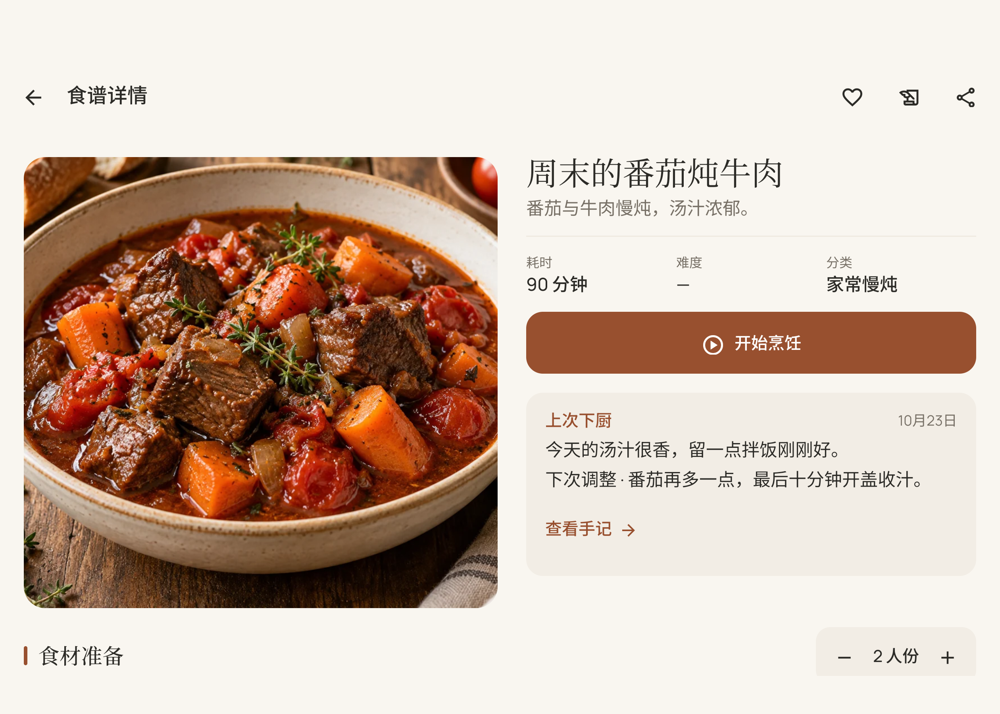
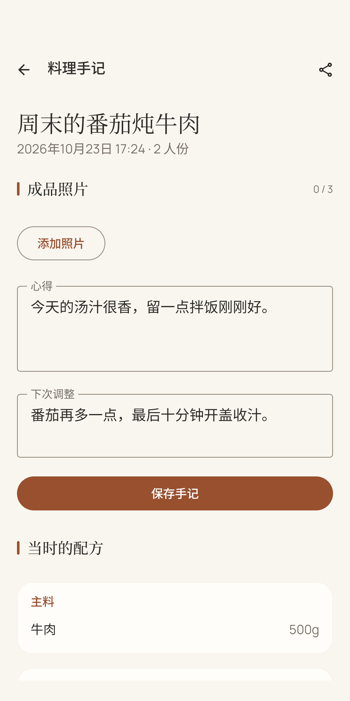
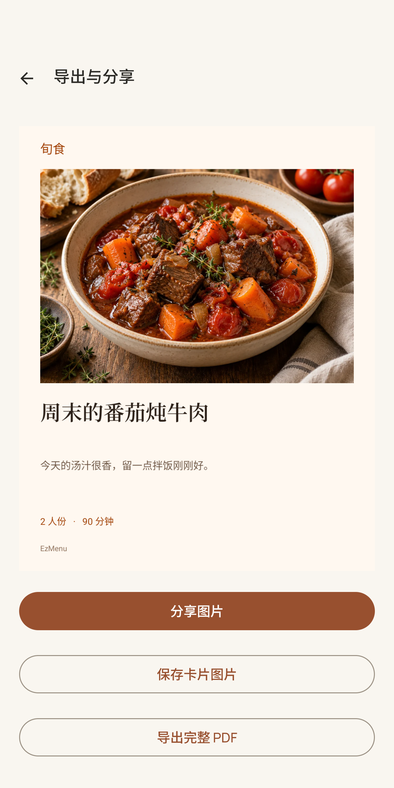

# 旬食 · EzMenu 2.0

## 产品定位

一个离线的中文私人食谱应用。产品围绕“收录 → 下厨 → 手记 → 再次下厨”展开：食谱记录做法，手记保留每次真实经历，下一次打开时看见上次留下的调整。

## 三个可以演示的设计决定

**把现在与过去分开。** 正式食谱可以不断修改，每次烹饪却冻结完整配方和实际份量。删除原菜谱后仍能查看手记。技术上用版本化 RecipeSnapshot 和独立日志引用实现，避免仅保存一个指向可变菜谱的 ID。

**让下厨过程可以中断。** 会话、步骤、备料与各步骤计时持久化，时间依据截止时刻计算。结束事务以会话 ID 去重。设备重启、普通进程重建、系统强制停止分别处理，不把后台协程当作可靠闹钟。

**把档案所有权交给用户。** 不需要账号或联网；完整备份带文件清单、格式版本与校验。恢复先验证、再确认替换，失败与中断保留回滚能力。分享只暴露专用导出目录的临时 URI。

## 视觉表达

暖纸白、焦糖橙和淡桃色，搭配中文衬线章节标题与清晰的无衬线正文。深色主题保留暖色气质；横屏调整信息密度，详情采用双栏。首页恢复「旬食」品牌标识，用细线料理标记和书卷感标题建立身份。中文字体补齐完整常用字库并使用真实字重，避免衬线与黑体混杂。食谱使用图片主导的双列卡片，详情压缩标题之外的装饰信息。内置封面使用为本项目生成的离线食物示意图，手记优先展示个人成品照片。

截图使用会在测试后清理的临时示例，**不代表产品伪造的个人使用记录**。

## 工程证据

- Kotlin / Compose / Room / DataStore，保留当前工具链主版本。
- 显式数据库 1→2 迁移，不清空旧内容。
- 字面搜索、真实食材推荐、轻量分页列表、后台图片处理与 EXIF 方向校正。
- 测试覆盖配方往返、并发完成、会话恢复、迁移、归档校验与恢复回滚。
- 多尺寸、多主题与 200% 字体检查；性能数据使用固定数据集和明确标注的模拟器环境。

完整检查结果、限制和复现方式见 [VERIFICATION.md](VERIFICATION.md)。本项目未对外宣称真实用户量、留存或商业成绩。

[演示录屏](portfolio/ezmenu-demo.mp4) · [项目说明](README.md) · [设计规范](DESIGN.md)
